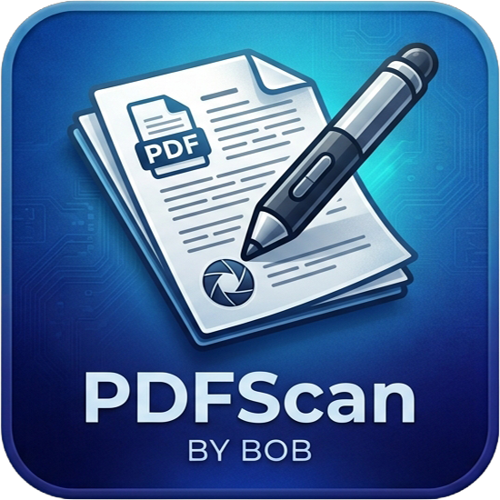

<p align="center">
  
</p>

# PDFScan by Bob

Ein Android-Dokumentenscanner (Kotlin · Jetpack Compose · CameraX · OpenCV 5).

## Funktionen

- **Kamera-Scan** mit Live-Kantenerkennung und automatischer Perspektivkorrektur
- **Auto-Auslösung** nach 3 Sekunden Ruhe (abbruchbar), alternativ manueller Knopf
- **Mehrseitiges Scannen** – beliebig viele Seiten pro Dokument
- **PDF-Export** direkt in den konfigurierbaren Scan-Ordner
- **Dokumentenverwaltung** – Ordner anlegen, umbenennen, löschen, kopieren, verschieben
- **Teilen** via `FileProvider` (`ACTION_SEND`)
- **Einstellbarer Scan-Ordner** – Standard `/Scans` im internen Speicher
- Sprachen: **Deutsch** (Standard) und **Englisch**

## Voraussetzungen & Installation (macOS)

### 1. Homebrew

```bash
/bin/bash -c "$(curl -fsSL https://raw.githubusercontent.com/Homebrew/install/HEAD/install.sh)"
```

### 2. Java 17

```bash
brew install openjdk@17
# Pfad für den Build dauerhaft setzen (z. B. in ~/.zshrc):
export JAVA_HOME=/opt/homebrew/opt/openjdk@17/libexec/openjdk.jdk/Contents/Home
```

### 3. Android SDK + `adb`

Einfachste Variante: **Android Studio** installieren (enthält SDK und `adb`):
<https://developer.android.com/studio>

Nur Kommandozeile (ohne IDE):
```bash
brew install --cask android-commandlinetools
# Dann SDK-Plattform installieren:
sdkmanager "platforms;android-35" "build-tools;35.0.0"
```

`adb` anschließend im PATH verfügbar machen (Android Studio legt es unter `~/Library/Android/sdk/platform-tools/` ab):
```bash
export PATH="$PATH:$HOME/Library/Android/sdk/platform-tools"
```

### Versionsübersicht

| Komponente | Version |
|---|---|
| Android (Mindest) | 10 (API 29) |
| Java (Build) | 17 (`openjdk@17` via Homebrew) |
| Gradle | 9.8.2 (Wrapper im Repo, kein separater Download) |
| AGP | 9.4.1 |

## Bauen

```bash
export JAVA_HOME=/opt/homebrew/opt/openjdk@17/libexec/openjdk.jdk/Contents/Home

# Debug-APK bauen
./gradlew assembleDebug

# Debug-APK direkt auf angeschlossenem Gerät installieren und starten
./gradlew installDebug

# Alternativ: fertige APK per adb installieren (-r = Reinstall)
adb install -r app/build/outputs/apk/debug/app-debug.apk
# Bei mehreren Geräten:
# adb devices                          → Geräte-IDs anzeigen
# adb -s <id> install -r <apk-pfad>

# Tests + Lint
./gradlew test lint

# Release-APK (erfordert keystore.properties)
./gradlew assembleRelease

# APKs mit Versionsname ins Projektwurzelverzeichnis kopieren
VERSION=$(cat VERSION)
cp app/build/outputs/apk/debug/app-debug.apk     "PDFScan-by-Bob-${VERSION}-debug.apk"
cp app/build/outputs/apk/release/app-release.apk "PDFScan-by-Bob-${VERSION}-release.apk"

# Installation auf angeschlossenem Gerät
adb install -r "PDFScan-by-Bob-${VERSION}-debug.apk"
```

> **Hinweis:** Die APKs im Root (`PDFScan-by-Bob-*.apk`) sind in `.gitignore` eingetragen und werden nicht committet.

> **⚠️ Launcher-Cache:** Niemals `adb shell pm clear <launcher-package>` ausführen – das löscht die gesamte Launcher-Konfiguration (Icon-Layout, Widgets). Ein `adb install -r` aktualisiert das App-Icon automatisch ohne Nebeneffekte.

## Signieren

### Variante A – Gradle mit `keystore.properties`

Erstelle `keystore.properties` im Projektwurzelverzeichnis (nicht im Git):

```properties
storeFile=patch-key.jks
PAPYRUS_STORE_PASSWORD=<passwort>
PAPYRUS_KEY_ALIAS=<alias>
PAPYRUS_KEY_PASSWORD=<passwort>
```

`./gradlew assembleRelease` signiert dann automatisch.

### Variante B – `uber-apk-signer.jar`

```bash
java -jar uber-apk-signer.jar \
  --apks app/build/outputs/apk/release/app-release-unsigned.apk \
  --ks patch-key.jks \
  --ksAlias <alias> \
  --ksKeyPass <passwort> \
  --ksPass <passwort> \
  --verbose
```

## Berechtigungen

| Berechtigung | Zweck |
|---|---|
| `CAMERA` | Kamera-Vorschau und Fotoaufnahme |
| `MANAGE_EXTERNAL_STORAGE` (API 30+) | Direkter Dateisystemzugriff auf `/Scans` |
| `READ/WRITE_EXTERNAL_STORAGE` (API 29) | Legacyzugriff auf externen Speicher |

> **Hinweis:** `MANAGE_EXTERNAL_STORAGE` schränkt die Aufnahme im Google Play Store stark ein. Die Verteilung ist als signierte APK geplant.

## Speicherort

Standard: `/storage/emulated/0/Scans`
Änderbar unter **Einstellungen → Scan-Ordner**.

## Lizenz

GPL-3.0-or-later, Copyright (C) 2025 hjochman.

Dieses Programm ist freie Software; die Lizenzbedingungen stehen in der Datei [`LICENSE`](LICENSE).
Quellcode: <https://github.com/hjochman/PDFScan-BY-BOB>
